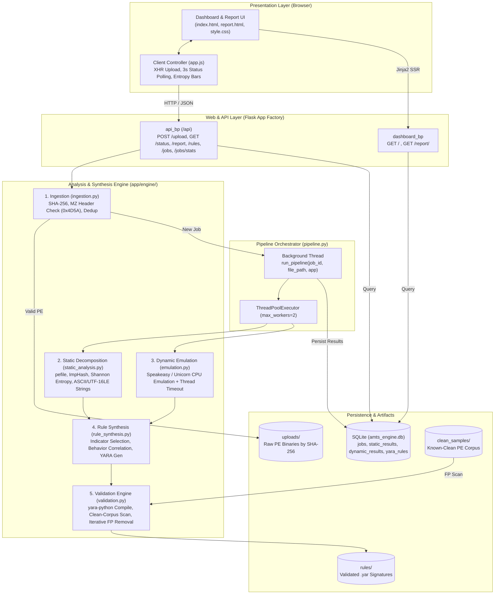
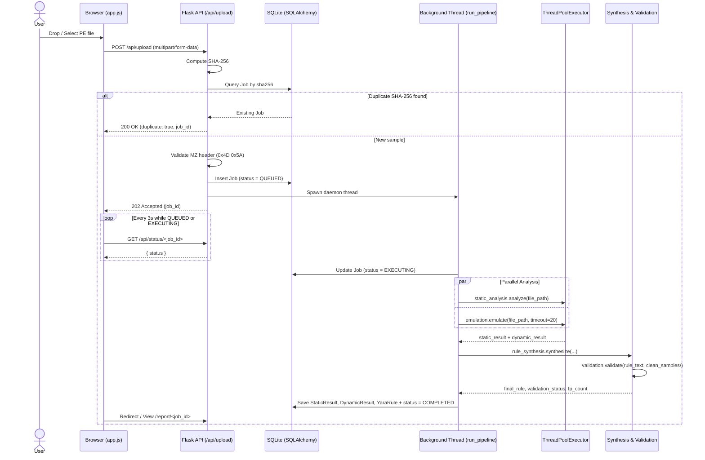
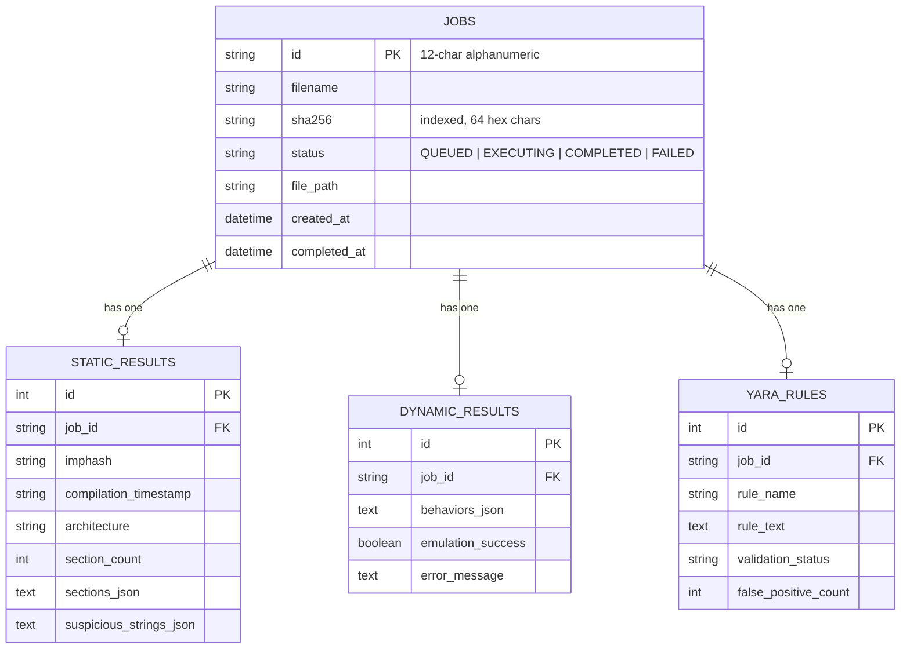

# AMTS-Engine

Automated Malware Triage and Dynamic YARA Rule Synthesis Engine

## Overview

AMTS-Engine is a web-based malware analysis platform that automates the process of
triaging Windows PE executables, performing static and dynamic analysis, and
synthesizing production-ready YARA detection rules. The system operates as a
continuous pipeline that accepts file uploads through a web interface, processes
them through parallel analysis stages, generates detection signatures, validates
them against known-clean files, and presents the results through an interactive
threat report dashboard.

## Architecture

AMTS-Engine is organized into **four decoupled layers** — Presentation/Web UI, REST API & Routing, Asynchronous Analysis Engine, and Persistence/Artifact Storage — executing a five-phase automated malware triage pipeline.

### High-Level Component Architecture



### End-to-End Request & Pipeline Sequence



### Architectural Layers & Responsibilities

1. **Application Factory & Configuration (`app/__init__.py`, `config.py`)**
   - `create_app()` initializes Flask, binds SQLAlchemy, ensures `uploads/`, `clean_samples/`, and `rules/` exist, registers `api_bp` (`/api`) and `dashboard_bp` (`/`), and runs `db.create_all()` on startup.
   - Global HTTP error handlers (`400`, `413`, `500`) return structured JSON for `/api/*` routes.

2. **Web & REST API Layer (`app/routes/`)**
   - **`dashboard_bp` (`dashboard.py`)**: Server-renders `index.html` (recent 20 jobs) and `report.html` (full triage report for a `job_id`).
   - **`api_bp` (`api.py`)**: Exposes JSON endpoints for upload, polling, full report retrieval, `.yar` download, job listing, and aggregate statistics (`/api/jobs/stats`).

3. **Concurrency & Execution Model (`app/engine/pipeline.py`, `emulation.py`)**
   - **Non-blocking ingestion**: `/api/upload` spawns a Python `threading.Thread(daemon=True)` running `run_pipeline()` inside `app.app_context()` so HTTP uploads return `202 Accepted` immediately.
   - **Parallel static + dynamic stage**: `run_pipeline()` uses a `ThreadPoolExecutor(max_workers=2)` to run `static_analysis.analyze()` and `emulation.emulate()` concurrently.
   - **Thread-enforced emulation timeout**: Because `speakeasy.Speakeasy.run_module()` does not accept a `timeout` keyword argument, `emulation.emulate()` executes Speakeasy inside a child daemon thread and enforces `EMULATION_TIMEOUT_SECONDS` via `thread.join(timeout=timeout)`.

4. **Client-Side Interactivity (`app/static/js/app.js`)**
   - Drag-and-drop / file-picker upload via `XMLHttpRequest` with upload progress tracking.
   - Live status polling (`initStatusPolling()`) re-queries `QUEUED`/`EXECUTING` table rows every 3 seconds and stops automatically once no pending jobs remain.
   - Section entropy bar widths are applied on `DOMContentLoaded` from `data-width` attributes (`initEntropyBars()`).

### Low-Level Architecture (Module Internals & Data Contracts)

#### 1. Ingestion Module (`app/engine/ingestion.py`)
- `compute_sha256(file_data) -> str`: Computes lowercase 64-char SHA-256 hex digest over raw buffered bytes.
- `validate_mz_header(file_data) -> bool`: Checks `len(file_data) >= 2 and file_data[0:2] == b"\x4d\x5a"`. Rejects non-PE uploads with HTTP `422`.
- `generate_job_id(length=12) -> str`: Samples 12 chars from `[A-Za-z0-9]`; `api.py` loops on `db.session.get(Job, job_id)` to guarantee primary-key uniqueness.
- `save_sample(file_data, sha256, upload_folder) -> str`: Persists raw binary to `uploads/<sha256>`.

#### 2. Static Decomposition (`app/engine/static_analysis.py`)
- `analyze(file_path, entropy_threshold=7.2) -> dict`:
  - Opens binary via `pefile.PE(file_path)` (returns `{"error": "Invalid PE file format", ...}` on `PEFormatError`).
  - Extracts COFF `TimeDateStamp` (UTC ISO-8601, falling back to `raw:<int>`), `Machine` mapped via `ARCH_MAP` (`0x14c` x86, `0x8664` x86-64, `0x1c0` ARM, `0xaa64` ARM64, `0x200` IA-64), `NumberOfSections`, and `pe.get_imphash()`.
  - **`calculate_shannon_entropy(data)`**: Builds a 256-bin byte frequency histogram and computes $-\sum p_i \log_2(p_i)$ rounded to 4 decimal places; sections with `entropy >= entropy_threshold` (`7.2`) get `is_packed: true`.
  - **String extraction**: `extract_ascii_strings(raw_data, min_length=6)` (`[\x20-\x7e]{6,}`) and `extract_unicode_strings(raw_data, min_length=6)` (`(?:[\x20-\x7e]\x00){6,}` decoded as `utf-16-le`).
  - **`filter_suspicious_strings(strings)`**: Deduplicates and discards `GENERIC_NOISE` / strings `< 4` chars, then classifies into `{value, type, fidelity}`:
    - `HIGH_FIDELITY_APIS` → `type: "suspicious_api", fidelity: "high"`
    - `MEDIUM_FIDELITY_APIS` → `type: "suspicious_api", fidelity: "medium"`
    - `URL_PATTERN` (`https?://[^\s"'<>]{8,}`) → `type: "url", fidelity: "high"`
    - `IP_STANDALONE` (IPv4 regex) → `type: "ip_address", fidelity: "high"`
    - `DOMAIN_STANDALONE` (FQDN + common TLDs) → `type: "domain", fidelity: "high"`

#### 3. Dynamic Emulation (`app/engine/emulation.py`)
- `emulate(file_path, timeout=20, max_instructions=1_000_000) -> dict`:
  - Instantiates `se.Speakeasy()`, calls `emu.load_module(file_path)`, `emu.run_module(module)`, and `emu.get_report()` inside a child daemon `threading.Thread` joined with `t.join(timeout=timeout)`.
  - Returns `{"behaviors": [...], "emulation_success": bool, "error_message": str | None}`.
- `parse_speakeasy_report(report) -> list[dict]`:
  - Iterates `report["entry_points"][*]["apis"]`, mapping `args` to `arg_0..arg_N` + `return_value`, and classifying `api_name` via `SEVERITY_MAP` (`Code Injection`, `Process Creation`, `Network Beaconing`, `Registry Modification`, `File Manipulation`, `Memory Allocation`, `Memory Modification`, `Dynamic Resolution`, `Cryptographic Activity`, `Anti-Analysis`, `Privilege Escalation`, `Input Capture`, or default `General API Call`).
  - Appends `report["network_events"]["dns"]` as `dns.resolve` and `report["network_events"]["traffic"]` as `network.connection` (both `Network Beaconing`).

#### 4. Rule Synthesis (`app/engine/rule_synthesis.py`)
- `extract_behavior_indicators(behaviors)`: Filters `behaviors` to high-severity categories (`Code Injection`, `Network Beaconing`, `Privilege Escalation`, `Input Capture`, `Process Hollowing`) and extracts `hostname`, `server`, `url` values (`len > 4`) as `type: "behavior_indicator", fidelity: "high"`.
- `select_rule_strings(suspicious_strings)`: Takes all `high` fidelity / network / behavior entries first; if `< 5`, backfills with `medium` fidelity entries up to 5.
- `synthesize(sha256, static_result, dynamic_result, match_threshold=3)`:
  - Rule name: `AMTS_<sha256[:16]>`.
  - Escapes `\` and `"` and strips control chars (`[\x00-\x1f\x7f-\x9f]`) via `clean_string_for_yara()`.
  - Emits `$imphash = { <hex bytes> }` (when available) and `$s0..$sN` strings; falls back to `$mz_marker = { 4D 5A }` if no indicators exist.
  - Condition builder always anchors on `uint16(0) == 0x5A4D` plus:
    - `($imphash or <effective_threshold> of ($s*))` when both `imphash` and `$s*` exist,
    - `$imphash` when only `imphash` exists,
    - `<effective_threshold> of ($s*)` when only `$s*` exists,
    - `$mz_marker` as fallback, where `effective_threshold = min(match_threshold, len(string_only_names))`.

#### 5. Validation & FP Remediation (`app/engine/validation.py`)
- `validate(rule_text, clean_dir, max_iterations=10) -> (final_rule, status, total_false_positives)`:
  - Returns `SKIPPED` if `yara-python` is unavailable, or `PASSED_NO_SAMPLES` if `clean_dir` has no files besides `README.md`.
  - Iterative loop (up to `max_iterations` = 10):
    1. `compile_rule(current_rule)` via `yara.compile(source=...)` (returns `COMPILATION_ERROR` on failure).
    2. `scan_clean_directory(compiled, clean_dir)` walks `clean_dir` with `compiled.match(filepath, timeout=10)`, collecting unique matched string identifiers (`$s*`).
    3. If `fp_matches` is empty → returns `(current_rule, "PASSED", total_false_positives)`.
    4. Otherwise increments `total_false_positives += len(fp_matches)` and calls `remove_offending_strings(current_rule, offending)`, which deletes matching `$sN = ...` lines and decrements `N of ($s*)` to `max(1, old_threshold - removed_count)`.
    5. If matches persist after 10 rounds → returns `(current_rule, "PARTIAL", total_false_positives)`.

#### 6. Pipeline Orchestration & Persistence (`app/engine/pipeline.py`, `app/models.py`)
- `run_pipeline(job_id, file_path, app)` runs inside `app.app_context()`:
  1. Transitions `Job.status` to `EXECUTING` and commits.
  2. Executes `static_analysis.analyze` and `emulation.emulate` in `ThreadPoolExecutor(max_workers=2)` via `as_completed()`.
  3. Persists `StaticResult` (`sections_json`, `suspicious_strings_json`) and `DynamicResult` (`behaviors_json`, `emulation_success`, `error_message`).
  4. Calls `rule_synthesis.synthesize()` → `validation.validate()` → writes `rules/<rule_name>.yar` (`os.makedirs(rules_dir, exist_ok=True)`).
  5. Persists `YaraRule`, sets `Job.status = "COMPLETED"` and `Job.completed_at = datetime.now(timezone.utc)`, and commits.

## System Requirements

- Python 3.9 or later
- pip package manager
- Windows, Linux, or macOS (Windows recommended for full PE emulation support)

### Required Python Packages

| Package | Purpose |
|---|---|
| Flask | Web framework and REST API |
| Flask-SQLAlchemy | ORM and database management |
| pefile | PE binary parsing and analysis |
| yara-python | YARA rule compilation and matching |
| speakeasy-emulator | Dynamic binary emulation (optional) |
| Werkzeug | HTTP utilities and file handling |

## Installation

### 1. Clone or Download the Project

```bash
cd /path/to/your/workspace
```

### 2. Create a Virtual Environment

```bash
python -m venv venv
```

Activate it:

- Windows: `venv\Scripts\activate`
- Linux/macOS: `source venv/bin/activate`

### 3. Install Dependencies

```bash
pip install -r requirements.txt
```

Note: `yara-python` requires a C compiler on some systems. On Windows, you may
need to install Visual C++ Build Tools. Alternatively, use a prebuilt wheel:

```bash
pip install yara-python
```

Note: `speakeasy-emulator` is optional. If it is not installed or fails to
initialize, the engine will skip the dynamic emulation phase and complete the
pipeline with static analysis results only. The generated YARA rule will be
based solely on static indicators in that case.

### 4. Populate Clean Samples (Recommended)

Copy known-clean Windows PE files into the `clean_samples/` directory. These are
used by the validation engine to test generated YARA rules for false positives.
See `clean_samples/README.md` for detailed instructions.

```powershell
Copy-Item C:\Windows\System32\notepad.exe .\clean_samples\
Copy-Item C:\Windows\System32\calc.exe .\clean_samples\
Copy-Item C:\Windows\System32\cmd.exe .\clean_samples\
```

### 5. Run the Application

```bash
python run.py
```

The server starts at `http://127.0.0.1:5000` by default.

## Usage

### Web Dashboard

1. Open `http://127.0.0.1:5000` in your browser.
2. Drag and drop a Windows PE executable (.exe, .dll, .sys) onto the upload zone,
   or click to browse files.
3. The file is validated (MZ header check) and queued for analysis.
4. The dashboard displays the job status, which transitions from QUEUED to
   EXECUTING to COMPLETED.
5. Click "View Report" to see the full threat analysis, including:
   - File metadata (SHA-256, architecture, compilation timestamp)
   - Section entropy analysis with visual bar chart
   - Suspicious string extraction (IPs, domains, URLs, API calls)
   - Dynamic behavior timeline (if emulation was successful)
   - Generated YARA rule with validation status
6. Download the YARA rule as a `.yar` file or copy it to clipboard.

### REST API

All functionality is available through the REST API for integration with
external tools and automation scripts.

#### Upload a File

```
POST /api/upload
Content-Type: multipart/form-data
```

Request body: multipart form data with a `file` field containing the PE binary.

Response (202 Accepted):
```json
{
    "job_id": "aB3kM9xQ7nWp",
    "filename": "sample.exe",
    "sha256": "e3b0c44298fc1c149afbf4c8996fb92427ae41e4649b934ca495991b7852b855",
    "status": "QUEUED",
    "file_path": "/path/to/uploads/e3b0c44298fc...",
    "duplicate": false
}
```

If the file has already been analyzed (matching SHA-256), the response returns
the existing job with `"duplicate": true` and status 200.

If the file does not have a valid MZ header, the response returns status 422
with an error message.

#### Check Job Status

```
GET /api/status/<job_id>
```

Response:
```json
{
    "job_id": "aB3kM9xQ7nWp",
    "filename": "sample.exe",
    "sha256": "e3b0c44298fc...",
    "status": "COMPLETED",
    "created_at": "2025-01-15T10:30:00",
    "completed_at": "2025-01-15T10:30:25"
}
```

Status values: `QUEUED`, `EXECUTING`, `COMPLETED`, `FAILED`.

#### Get Full Report

```
GET /api/report/<job_id>
```

Returns a JSON object containing all analysis results:

```json
{
    "job_id": "aB3kM9xQ7nWp",
    "filename": "sample.exe",
    "sha256": "e3b0c44298fc...",
    "status": "COMPLETED",
    "static_analysis": {
        "imphash": "d4a0e3c5b2f1a8e7...",
        "compilation_timestamp": "2024-03-15T08:22:00+00:00",
        "architecture": "x86 (i386)",
        "section_count": 5,
        "sections": [
            {
                "name": ".text",
                "entropy": 6.4521,
                "is_packed": false,
                "virtual_size": 32768,
                "raw_size": 32768
            },
            {
                "name": ".rsrc",
                "entropy": 7.8912,
                "is_packed": true,
                "virtual_size": 65536,
                "raw_size": 65536
            }
        ],
        "suspicious_strings": [
            {"value": "192.168.1.100", "type": "ip_address"},
            {"value": "malware-c2.evil.com", "type": "domain"},
            {"value": "CreateRemoteThread", "type": "suspicious_api"}
        ]
    },
    "dynamic_analysis": {
        "behaviors": [
            {
                "elapsed_ms": 150,
                "function": "kernel32.CreateRemoteThread",
                "arguments": {"arg_0": "0x1234", "arg_1": "0x5678"},
                "severity": "Code Injection"
            }
        ],
        "emulation_success": true,
        "error_message": null
    },
    "yara_rule": {
        "rule_name": "AMTS_e3b0c44298fc1c14",
        "rule_text": "rule AMTS_e3b0c44298fc1c14 { ... }",
        "validation_status": "PASSED",
        "false_positive_count": 0
    }
}
```

#### Download YARA Rule

```
GET /api/rules/<job_id>
```

Returns the raw YARA rule text as a downloadable `.yar` file.

#### List Recent Jobs

```
GET /api/jobs
```

Returns an array of the 50 most recent jobs.

#### Get Aggregate Job Statistics

```
GET /api/jobs/stats
```

Returns aggregate counts across all jobs in the database (`total_jobs`, `completed`, `failed`, `in_progress`, `emulation_success_count`, `total_false_positives_remediated`, `rules_passed_validation`).

## Pipeline Phase Details

### Phase 1: Ingestion

The ingestion API receives the uploaded file through an HTTP multipart form
request. It buffers the file in memory and computes a SHA-256 hash. The system
checks the database for this hash. If it already exists, the pipeline stops and
returns the existing report to avoid redundant processing. If the hash is new,
the engine reads the first two bytes of the file and verifies they match the
hexadecimal values 0x4D and 0x5A (the standard Windows MZ executable signature).
Valid files are saved to the `uploads/` directory using their hash as the
filename, and a unique 12-character alphanumeric job identifier is assigned.

### Phase 2: Static Decomposition

The engine opens the saved binary and parses its PE headers using the pefile
library. It extracts:

- **Compilation Timestamp**: The date the binary was compiled, from the PE
  COFF header.
- **Target Architecture**: CPU architecture (x86, x86-64, ARM, ARM64) from
  the Machine field.
- **Section Count**: Number of PE sections.
- **Import Hash (ImpHash)**: An MD5 fingerprint of the binary's import table,
  created by hashing the lowercase names of all imported DLLs and functions.
  This fingerprint identifies families of malware that share the same software
  dependencies.
- **Section Entropy**: Shannon entropy is calculated for each section of the
  binary. The formula measures byte distribution randomness on a scale of 0.0
  to 8.0. Sections scoring 7.2 or higher are flagged as potentially packed or
  encrypted, since legitimate code typically has entropy between 5.0 and 7.0.
- **String Extraction**: The engine scans the entire binary for continuous
  sequences of ASCII and Unicode characters (minimum 4 characters). Extracted
  strings are filtered against regular expressions for IP addresses, domain
  names, URLs, and a list of over 50 known suspicious Windows API function
  names associated with process injection, network communication, registry
  modification, anti-analysis, and cryptographic operations.

### Phase 3: Dynamic Emulation

The engine uses the speakeasy-emulator framework (by Mandiant) to emulate the
binary in a simulated 64-bit Windows environment. Speakeasy creates fake
registry paths, files, and memory spaces. It loads the binary into virtual
memory and places monitoring hooks on critical system libraries including
kernel32.dll, advapi32.dll, and ws2_32.dll. The binary is executed from its
entry point with a configurable timeout (default: 20 seconds).

Every intercepted API call is recorded with:
- Elapsed milliseconds since execution started
- The library and function name (e.g., kernel32.CreateRemoteThread)
- A key-value map of the function arguments
- A severity category assigned by the behavior classifier

Severity categories include:
- **Code Injection**: CreateRemoteThread, WriteProcessMemory, VirtualAllocEx
- **Network Beaconing**: InternetOpenA, URLDownloadToFileA, socket, connect
- **Registry Modification**: RegSetValueExA, RegCreateKeyExA
- **Process Creation**: CreateProcessA, WinExec, ShellExecuteA
- **File Manipulation**: CreateFileA, WriteFile, DeleteFileA
- **Anti-Analysis**: IsDebuggerPresent, GetTickCount
- **Privilege Escalation**: AdjustTokenPrivileges
- **Cryptographic Activity**: CryptEncrypt, CryptDecrypt

If speakeasy is not installed or the emulation fails (e.g., unsupported binary
format), the pipeline continues with static analysis results only. The report
notes the emulation skip reason.

### Phase 4: Rule Synthesis

The engine combines the unique strings, import hash, and behavioral indicators
collected from the previous phases. It filters strings to remove generic PE
labels (e.g., .text, .data, .rdata, PADDING, VS_VERSION_INFO) and retains only
high-fidelity indicators such as IP addresses, domain names, URLs, and
suspicious API names.

It generates a YARA rule with the following structure:

- **meta**: SHA-256 hash, author ("AMTS-Engine"), generation timestamp,
  description, packed section list, and emulation status.
- **strings**: The import hash as a hex pattern, and each filtered string as
  a named variable ($s0, $s1, etc.).
- **condition**: A boolean expression requiring the file to have a valid MZ
  header (`uint16(0) == 0x5A4D`) combined with either the exact import hash
  match or a minimum count of the extracted unique strings (configurable
  threshold, default: 3).

### Phase 5: Validation

The engine compiles the generated YARA rule using yara-python and scans it
against all files in the `clean_samples/` directory. This directory should
contain at least 10 known-clean Windows system files (e.g., notepad.exe,
calc.exe, cmd.exe).

If the rule matches any clean file (a false positive), the engine identifies
the specific string that caused the match, removes it from the rule, adjusts
the condition threshold, and re-runs the validation scan. This iterative
refinement continues for up to 10 rounds until the rule produces zero matches
on the clean file set.

If the rule passes validation, it is marked as PASSED and saved as a `.yar`
file in the `rules/` directory. The complete analysis data and final rule are
stored in the SQLite database.

## Configuration

The application is configured through `config.py`. Key settings:

| Setting | Default | Description |
|---|---|---|
| MAX_CONTENT_LENGTH | 16 MB | Maximum upload file size |
| ENTROPY_PACKING_THRESHOLD | 7.2 | Entropy score above which a section is flagged as packed |
| EMULATION_TIMEOUT_SECONDS | 20 | Maximum emulation duration in seconds |
| EMULATION_MAX_INSTRUCTIONS | 1,000,000 | Maximum CPU instructions to emulate |
| MIN_STRING_LENGTH | 4 | Minimum character length for extracted strings |
| YARA_STRING_MATCH_THRESHOLD | 3 | Number of strings required to match in the YARA condition |
| UPLOAD_FOLDER | ./uploads | Directory for stored samples |
| CLEAN_SAMPLES_DIR | ./clean_samples | Directory of known-clean files for validation |
| RULES_OUTPUT_DIR | ./rules | Directory for generated YARA rule files |

## Project Structure

```
Major Project/
    config.py                   Application configuration
    run.py                      Flask entry point
    requirements.txt            Python dependencies
    amts_engine.db              SQLite database (auto-created)
    app/
        __init__.py             Flask app factory
        models.py               SQLAlchemy database models
        routes/
            __init__.py
            api.py              REST API endpoints
            dashboard.py        Web dashboard routes
        engine/
            __init__.py
            ingestion.py        SHA-256 hashing, MZ validation, file storage
            static_analysis.py  PE parsing, entropy, imphash, string extraction
            emulation.py        Speakeasy-based dynamic analysis
            rule_synthesis.py   YARA rule generation
            validation.py       False positive testing and remediation
            pipeline.py         Analysis pipeline orchestrator
        templates/
            base.html           Base layout template
            index.html          Upload and dashboard page
            report.html         Threat analysis report page
        static/
            css/
                style.css       Dark-mode UI stylesheet
            js/
                app.js          Client-side upload and polling logic
    clean_samples/
        README.md               Setup instructions for clean validation files
    tests/
        __init__.py
        test_full_pipeline.py   37-test integration suite (emulation, static, YARA, DB, API)
    uploads/                    Stored sample binaries (by SHA-256 hash)
    rules/                      Generated YARA rule files (.yar)
    verify_system.py            Recursive end-to-end system verification script
```

## Database Schema

The application uses SQLite via SQLAlchemy with four 1-to-1 linked tables (`Job` cascades deletes to its child records):



- **jobs**: Core job tracking with `id`, `filename`, `sha256`, `status`, `file_path`, `created_at`, and `completed_at` fields.
- **static_results**: Static analysis output linked to a job. Stores `imphash`, `compilation_timestamp`, `architecture`, `section_count`, and JSON-encoded section details and suspicious strings.
- **dynamic_results**: Dynamic analysis output linked to a job. Stores JSON-encoded behavior log, `emulation_success` flag, and `error_message`.
- **yara_rules**: Generated YARA rules linked to a job. Stores `rule_name`, full `rule_text`, `validation_status`, and `false_positive_count`.

## Troubleshooting

### yara-python installation fails

On Windows, install Visual C++ Build Tools first, or use a prebuilt wheel:
```bash
pip install yara-python
```

On Linux:
```bash
sudo apt-get install -y libyara-dev
pip install yara-python
```

### speakeasy-emulator not working

Speakeasy requires the Unicorn engine. If installation fails:
```bash
pip install unicorn
pip install speakeasy-emulator
```

The engine is designed to work without speakeasy. If it is not installed, the
pipeline completes with static analysis only and notes the skip in the report.

### Empty entropy chart or no sections

This usually means the uploaded file is not a valid PE executable. The engine
only processes files with a valid MZ header (first two bytes: 0x4D 0x5A).

### YARA rule validation shows "PASSED_NO_SAMPLES"

This means the `clean_samples/` directory is empty. Populate it with clean
Windows PE files to enable false positive detection. See
`clean_samples/README.md` for instructions.

### Database reset

To reset the database and start fresh, delete the `amts_engine.db` file and
restart the application. The database will be recreated automatically.

## Limitations

- The emulation engine (speakeasy) simulates a subset of the Windows API. Some
  advanced malware techniques that rely on unsupported APIs may not be captured.
- YARA rule quality depends on the distinctiveness of the analyzed sample.
  Heavily packed or obfuscated binaries may produce rules with fewer indicators.
- The validation phase can only detect false positives against the files present
  in the clean_samples directory. A larger and more diverse set of clean files
  improves validation coverage.
- The application uses threading for parallel analysis, which is suitable for
  development and moderate workloads. For high-throughput production use, a
  dedicated task queue (e.g., Celery) is recommended.

## License

This project is developed for academic purposes.
